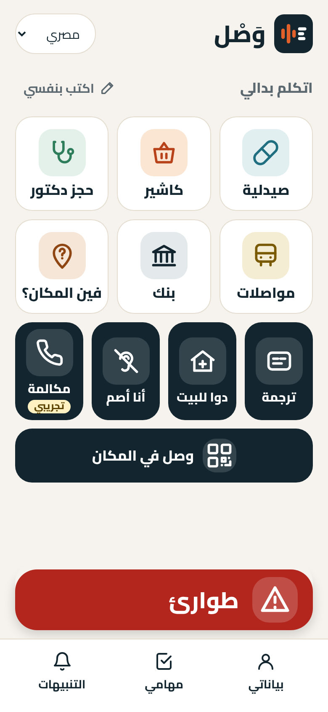
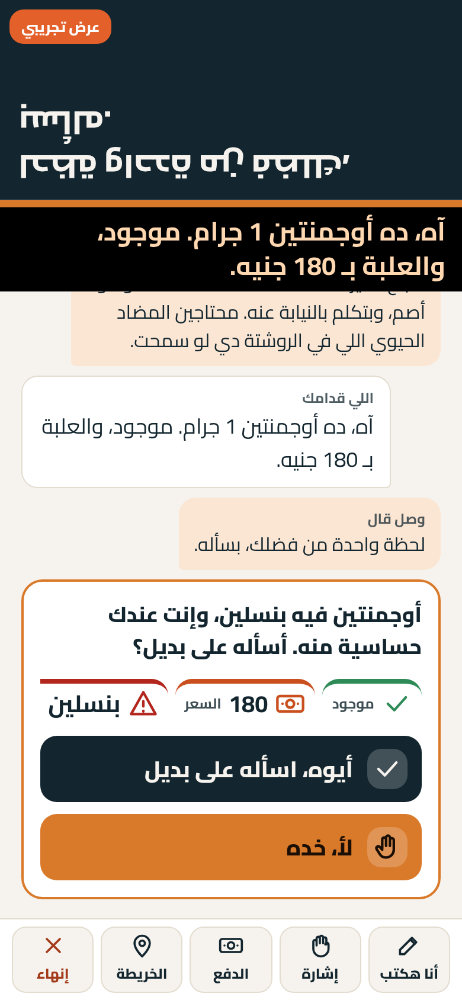
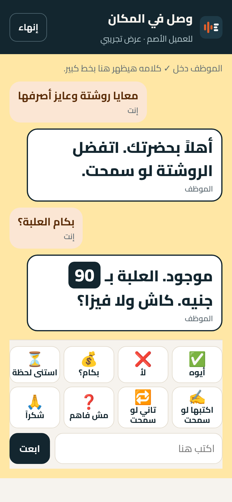
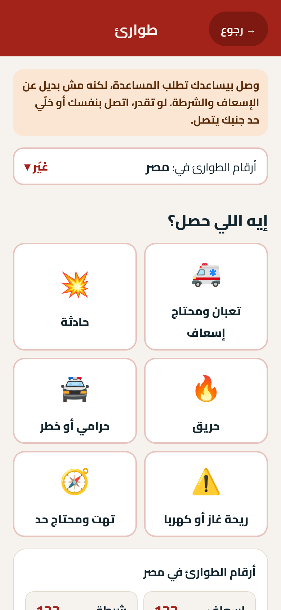

# وَصْل (Wasl)

**احنا مش مترجم، احنا بنخلّص المصلحة.**

وَصْل تطبيق مجاني للصم وضعاف السمع في مصر. بيتكلم بالنيابة عنك بصوت مصري واضح، وبيكتبلك كلام اللي قدامك ومعاه صور.
في الصيدلية، عند الدكتور، في البنك، في المكالمات، وعلى واتساب.

- 📱 **جرّب التطبيق:** https://wasl.nrg-egypt.com (بيفتح من المتصفح، من غير تحميل)
- ▶️ **العرض التجريبي (بيشتغل من غير نت):** https://wasl.nrg-egypt.com/?demo ← دوس «▶ عرض تجريبي»
- 🌐 **عن وَصْل:** https://wasl.nrg-egypt.com/site/
- ✍️ **التسجيل في التجربة:** https://wasl.nrg-egypt.com/join.html
- 🔒 **الخصوصية:** https://wasl.nrg-egypt.com/privacy.html

## المشكلة
الشخص الأصم في مصر محتاج حد يتكلم بداله في أبسط مصلحة: يصرف روشتة، يحجز عند دكتور، يدفع فاتورة.
المترجمين قليلين، والكتابة على ورقة بطيئة، وناس كتير من الصم قراءتهم محدودة.

## وَصْل بيعمل إيه

| | |
|---|---|
| 💊 **وجهاً لوجه** | بتقول عايز إيه (كتابة أو صورة أو تصوير الروشتة)، ووَصْل يتكلم مع اللي قدامك بأدب. كلامه بيظهرلك مكتوب ومعاه كروت (السعر، موجود ولا لأ، الجرعة). |
| ⚠️ **الأمان** | بيراجع الحساسية من الأدوية قبل أي حاجة. وأي قرار فيه فلوس أو صحة بيرجعلك إنت بأزرار واضحة. |
| 💬 **دوا على واتساب** | بيكتب طلب الدوا للصيدلية من واتساب بتاعك، وبيحوّل رد الصيدلية الصوتي لكلام مكتوب. |
| 🔳 **وصل في المكان** | كل فرع فيه **ستيكرين**: ستيكر للعميل وستيكر لموبايل الفرع. العميل الأصم يعمل سكان، ويختار طلبه بالصور (فاتورة كهربا، شحن رصيد، معايا روشتة...). موبايل الفرع **بيرن ويفتح المحادثة لوحده**، والموظف يتكلم بصوته أو يكتب، وكلامه بيظهر للعميل بخط كبير. ولو الموظف معندوش موبايل، يتكلموا على موبايل العميل. وفي الآخر العميل يجاوب «مصلحتك خلصت؟». |
| 📞 **مكالمة (تجريبي)** | وَصْل يتصل بدالك ويقول اللي إنت عايزه، وإنت بتقرا المكالمة مكتوبة. المكالمات دلوقتي تجريبية ومش مفتوحة للناس، والتشغيل الكامل هيبقى بالشراكة مع شركة اتصالات زي فودافون. |
| 🚨 **طوارئ** | صفارة وكشاف عشان اللي حواليك ياخدوا بالهم، ومكانك بيتبعت لأهلك، وكلام جاهز للإسعاف والشرطة. |
| 🔔 **تنبيهات الأصوات** | الموبايل يهتز لما يسمع جرس الباب أو بكا طفل أو إنذار حريق. |
| 🖼️ **وضع الصور** | لمين قراءته ضعيفة: كل حاجة بأيقونات كبيرة وكلام قليل. |

## صور

| الرئيسية (وضع الصور) | في الصيدلية | وصل في المكان | طوارئ |
|---|---|---|---|
|  |  |  |  |
| | الكلام اللي فوق مقلوب عشان الصيدلي يقراه من الناحية التانية. | | |

## جرّب العرض في دقيقة
1. افتح https://wasl.nrg-egypt.com/?demo على الموبايل.
2. اختار «بفضّل الصور»، وبعدين دوس «▶ عرض تجريبي».
3. جرّب الأربع مشاهد بالترتيب: **صيدلية ← واتساب ← وصل في المكان ← طوارئ**.

العرض كله بيشتغل من غير نت بعد أول فتحة. ولو عايز صوت وَصْل الحقيقي من غير نت، دوس مرة واحدة وإنت على النت على «حضّر أصوات العرض» من «بياناتي». من غيرها بيتكلم بصوت الموبايل نفسه.

## الخصوصية باختصار
- مفيش حساب. بياناتك (الاسم، الحساسية، أرقام الطوارئ) بتفضل على موبايلك.
- المحادثات مش بتتسجّل. ومفيش إعلانات ولا بيع بيانات.
- الأماكن والرعاة بيشوفوا أرقام إجمالية بس في صفحة الراعي، عمرهم ما يشوفوا كلام أو بيانات شخص، وأي رقم أقل من 5 بيستخبى.

## إزاي معمول
- **التطبيق:** PWA في ملف واحد (`index.html`)، عربي RTL، الموبايل الأول، وبيشتغل offline بالـservice worker (`sw.js`).
- **الذكاء:** الباك إند على n8n في `api.nrg-egypt.com`: Claude من Anthropic للمهام وقراءة الصور، وElevenLabs للصوت المصري وتحويل الرسايل الصوتية لكتابة. المفاتيح كلها على السيرفر، مفيش ولا مفتاح في الكود.
- **على الموبايل نفسه:** فهم كلام اللي قدامك (خدمة الكلام في المتصفح)، وتنبيهات الأصوات، والتعرّف على الإشارات اللي المستخدم بيعلّمها لوَصْل.

| الملف | إيه هو |
|---|---|
| `index.html` | التطبيق |
| `counter.html` | وصل في المكان (`?demo` للعرض من غير نت) |
| `sponsor.html` | صفحة الراعي: كام مصلحة خلصت في فروعه (أرقام بس) |
| `site/` | صفحة التعريف |
| `join.html` / `feedback.html` | التسجيل في التجربة / التقييم |
| `record.html` / `review.html` / `signs/` | تصوير ومراجعة مكتبة الإشارة المصرية (لسه بتتصوّر) |
| `tests/smoke.js` | اختبار كل الصفحات على موبايلين |

## للمطوّرين
قواعد المشروع في [`CLAUDE.md`](CLAUDE.md). وقبل أي commit:

```bash
node tests/smoke.js
```

بيفتح كل الصفحات على 375×667 و390×844، والسيرفر معمول له mock، وبيتأكد من أربع حاجات: مفيش أخطاء، ومفيش scroll بالعرض، والأزرار 48px على الأقل، والعرض التجريبي شغّال.

---

**English:** Wasl is a free Arabic web app for Deaf and hard-of-hearing people in Egypt. It speaks for the user in clear Egyptian Arabic and shows the other person's words as text and pictures, face to face, at a branch counter (QR), on calls and on WhatsApp. It doesn't just translate: it gets the errand done. Try the offline demo at https://wasl.nrg-egypt.com/?demo. Made by NRG.
